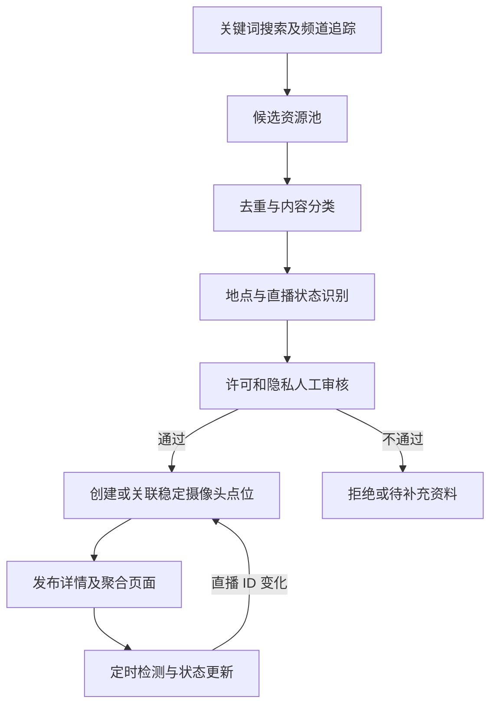
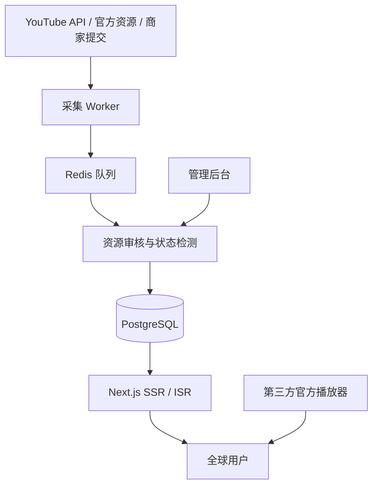

# 全球实时摄像头直播平台 — 产品需求分析文档

> 版本：V1.0 | 产品阶段：MVP | 日期：2026-11-24
> 暂定产品名称：LiveCam Global（品牌及域名待定）
> 参考产品：SkylineWebcams、EarthCam、WebcamTaxi、Windy Webcams

## 1. 项目背景

全球各地的酒店、景区、旅游机构、动物园及个人运营者拥有大量实时景观摄像头，但资源分散在不同网站及视频平台。用户需要一个统一入口，按地理位置、内容类型和实时状态发现世界各地的景观。

项目初期通过授权直播资源聚合建立内容库，使用官方嵌入播放器降低视频分发成本，通过独立内容、地图、天气、当地时间及多语言页面形成用户价值和搜索入口。长期开放商家自主接入，建立自有直播网络。

### 1.1 产品定位

面向全球用户的实时景观发现与虚拟旅游平台，同时为酒店、民宿、景区及摄像头运营者提供公开景观直播营销服务。

### 1.2 核心原则

- C 端基础观看免费，无需注册。
- 优先获取明确允许使用的公开景观直播资源。
- MVP 不采购硬件、不进行大规模地推、不自行转发第三方视频。
- 以独立站 SEO、内容质量、直播可用性为增长核心。
- B 端初期免费接入，待价值和单位经济性得到验证后商业化。
- 不接入私人监控、未经授权的安防摄像头及敏感地点直播。

### 1.3 产品阶段

| 阶段 | 目标 | 主要模式 |
|---|---|---|
| MVP | 300 个审核通过且可播放的点位 | 官方播放器嵌入、内容目录 |
| V1.1 | 扩展至 1,000 个有效点位 | 自动发现、地图、国际化 |
| V2 | 验证 10–30 个直接合作点位 | 商家提交、独立品牌展示 |
| V3 | 验证自有推流的单位经济性 | RTMPS/SRT 接入、设备管理 |
| V4 | 建立可持续合作网络 | OEM 硬件、企业服务、会员 |

以上为规划目标，不代表已取得资源或预期收入。

## 2. 市场与竞品

| 竞品 | 地址 | 可借鉴方向 |
|---|---|---|
| SkylineWebcams | https://www.skylinewebcams.com/ | 地理层级、多语言、商家合作、硬件服务 |
| EarthCam | https://www.earthcam.com/ | 地标直播、企业服务 |
| WebcamTaxi | https://www.webcamtaxi.com/ | 分类目录和全球景观发现 |
| Windy | https://www.windy.com/ | 地图探索、天气结合 |
| Explore | https://explore.org/ | 自然与动物垂直内容 |
| CamListed | https://camlisted.com/ | 直播资源目录与发现 |

竞品仅作产品研究和资源线索，不视为可直接采集、转载或商业使用的授权来源。当前市场规模、竞品收入和资源数量需要独立核实。

### 2.1 SWOT

| 优势 S | 劣势 W |
|---|---|
| 实时内容持续变化；长尾地点搜索丰富；官方嵌入可降低初期分发成本 | 第三方直播易失效；授权审核耗时；头部网站积累深厚 |

| 机会 O | 威胁 T |
|---|---|
| 随机探索、天气联动、小语种、酒店营销、独家点位 | 平台条款变化、版权与隐私风险、SEO 同质化、带宽成本 |

## 3. 用户角色与需求

| 用户 | 核心需求 | 产品能力 |
|---|---|---|
| 游客 | 查看目的地天气、环境和现场情况 | 地点搜索、地图、当地时间、直播 |
| 虚拟旅行用户 | 随机探索世界、放松陪伴 | 随机直播、分类、全屏 |
| 自然爱好者 | 观察动物、火山、海洋等 | 专题分类、收藏 |
| 酒店/景区 | 展示景观、品牌曝光、官网引流 | 专属页面、品牌链接、嵌入组件、统计 |
| 摄像头运营者 | 扩大内容传播 | 资源提交、归属标注、管理及下架 |
| 管理员 | 控制质量、授权和在线状态 | 审核、监控、采集、SEO 管理 |

## 4. 产品信息架构

```text
全球直播平台
├── 首页
├── 全球地图 /map
├── 国家目录 /countries
│   └── 国家 /countries/{country}
│       └── 城市 /countries/{country}/{city}
├── 分类 /categories/{category}
├── 直播详情 /webcams/{slug}
├── 随机直播 /random
├── 搜索 /search
├── 热门 /popular
├── 最新 /new
├── 收藏 /favorites
├── 提交直播 /submit
├── 商家合作 /partners
│   ├── 接入说明
│   ├── 商家控制台（后续）
│   └── 摄像头购买（后续）
├── 关于、隐私、条款、版权投诉
└── 管理后台 /admin
```

默认英语，后续采用 /{locale}/ 前缀。固定点位 slug 不随直播视频 ID 变化，避免 SEO 资产丢失。

## 5. 功能需求

优先级：P0 为 MVP 必需；P1 为增长功能；P2 为商业化或规模化功能。

| 编号 | 功能 | 优先级 | 验收标准 |
|---|---|---|---|
| F01 | 首页 | P0 | 展示在线直播、分类、热门国家、搜索及随机入口；列表不自动加载视频 |
| F02 | 国家/城市目录 | P0 | 按地理位置浏览有效点位，支持分页和面包屑 |
| F03 | 分类目录 | P0 | 城市、海滩、动物、自然、铁路、机场、滑雪场、港口等分类 |
| F04 | 直播详情 | P0 | 官方嵌入播放器、来源署名、地点、时间、天气、相关直播、举报 |
| F05 | 搜索 | P0 | 支持国家、城市、景点、分类和名称，支持无结果提示 |
| F06 | 随机直播 | P0 | 仅从审核通过且可播放的点位随机选择，支持再次随机 |
| F07 | 全球地图 | P0 | 点位聚合、缩放、分类过滤、点击打开详情；使用合规地图服务 |
| F08 | 直播资源提交 | P0 | 提交链接、地点、运营方、联系方式及授权声明；不自动发布 |
| F09 | 资源管理后台 | P0 | 新增、编辑、去重、批量审核、暂停、下架、审核日志 |
| F10 | 状态检测 | P0 | 定时检测、失败重试、记录状态及最后验证时间 |
| F11 | SEO 管理 | P0 | SSR、规范链接、Sitemap、索引控制、独立标题描述 |
| F12 | 收藏 | P1 | 本地收藏优先，登录后可同步 |
| F13 | 排行榜 | P1 | 基于有效观看和访问统计生成，过滤异常行为 |
| F14 | 国际化 | P1 | 英语优先，后续支持日语、西语、德语、法语等 |
| F15 | 天气主题发现 | P1 | 按天气、日出日落及当地昼夜发现直播 |
| F16 | 商家控制台 | P1 | 认领审核、编辑资料、统计、下架申请 |
| F17 | 多屏观看 | P2 | 支持多路播放器，控制资源占用 |
| F18 | 自有摄像头推流 | P2 | RTMPS/SRT 接入、独立鉴权、状态监控、HLS 分发 |
| F19 | 硬件商城 | P2 | 设备销售、绑定、物流、售后 |
| F20 | 会员和企业增值 | P2 | 自有广告移除、企业统计及定制展示 |

### 5.1 首页

- 顶部：Logo、搜索框、地图、国家、分类、随机直播、语言选择。
- 首屏：精选直播卡片和全球探索入口。
- 内容区：热门直播、热门国家、分类、最新直播、昼夜主题。
- 卡片：预览图、标题、城市、国家、来源、直播状态。
- 底部：合作入口、版权政策、隐私政策、联系方式。
- 禁止同时自动播放多个视频；预览图须来自允许使用的来源。

### 5.2 直播详情页

```text
面包屑：首页 > 日本 > 东京
H1：Tokyo Live Webcam
[官方视频播放器]
[直播状态] [当地时间] [天气] [收藏] [分享]
地点介绍 / 景观特色 / 最佳观看时间
来源署名 / 原始链接 / 商家官网（如获授权）
地图位置 / 附近直播
同类型直播 / 举报问题
```

- 对真实连续视频、定时快照、延时摄影、录播分别标识，不把快照或录播冒充实时直播。
- 播放失败时显示状态、原始来源链接及替代点位。
- 原始播放器必须保持其品牌、广告和必要功能，不得遮挡或绕过限制。
- 不公开摄像头管理 IP、设备密码或私有推流地址。
- 位置精度根据公开信息和隐私风险决定，不展示非公开精确位置。

### 5.3 地图与随机直播

地图支持国家、分类、在线状态过滤，以及可见区域加载和聚合。随机功能支持全球随机、指定国家随机、指定分类随机，避免短时间重复推荐，并排除离线、待审核、限制地区不可用的资源。

### 5.4 管理后台

- 采集任务：关键词、渠道、执行日志、配额及失败重试。
- 候选池：来源、重复候选、地点识别、画质及类别。
- 审核台：播放测试、许可依据、隐私风险、分类、人工确认。
- 直播管理：稳定点位、当前直播、历史直播、暂停、重新关联。
- 内容管理：国家、城市、分类、原创介绍、多语言。
- SEO 管理：索引状态、Sitemap、重定向、质量问题。
- 商家管理：申请、认领、授权文件、联系记录。
- 投诉中心：举报、版权请求、临时下架及审计日志。

## 6. 直播资源采集方案

### 6.1 数据来源

| 来源 | 作用 | 使用方式 |
|---|---|---|
| YouTube Data API | 主要候选资源发现 | 搜索直播、跟踪频道、官方嵌入 |
| Windy Webcams API | 地图及天气摄像头线索 | 按许可套餐使用，区分快照与视频 |
| 政府、国家公园、旅游机构 | 优质景观线索 | 检查条款，获得许可后展示 |
| 酒店、景区官网 | 独家合作线索 | 联系运营方或使用明确许可的组件 |
| 摄像头目录网站 | 发现运营方 | 不未经许可抓取数据库或复制直播流 |
| 用户/商家提交 | 长期资源供给 | 审核权属、场地许可及公开传播授权 |

参考接口：

- YouTube Search API：https://developers.google.com/youtube/v3/docs/search/list
- YouTube Videos API：https://developers.google.com/youtube/v3/docs/videos/list
- YouTube 开发者政策：https://developers.google.com/youtube/terms/developer-policies
- Windy Webcams API：https://api.windy.com/webcams/pricing
- US National Park Service：https://www.nps.gov/
- USGS：https://www.usgs.gov/

具体 API 配额、价格、数据保存及商业使用权限以实施时官方规则和合同为准。

### 6.2 自动发现流程



YouTube 搜索参数建议：type=video、eventType=live、videoEmbeddable=true。再通过 videos.list 检查状态、嵌入许可和直播详情。API 返回可嵌入不等于获得重新分发、任意商业使用或下载视频的许可。

关键词种子：live webcam、beach live cam、city live camera、wildlife live cam、train live webcam、ski resort webcam、volcano live cam、ライブカメラ、webcam en direct、webcam en directo。结合国家、城市及景点建立搜索任务。

### 6.3 首批资源目标

| 分类 | MVP 目标 | 扩展目标 |
|---|---:|---:|
| 城市街景 | 75 | 250 |
| 海滩 | 55 | 180 |
| 自然风景 | 45 | 150 |
| 铁路 | 30 | 100 |
| 动物 | 30 | 100 |
| 机场 | 20 | 70 |
| 滑雪场 | 20 | 60 |
| 港口 | 10 | 40 |
| 火山 | 10 | 30 |
| 其他 | 5 | 20 |
| 合计 | 300 | 1,000 |

初期建议覆盖 20–30 个国家，实际分布由有效授权资源决定，不为了凑数量引入低质量内容。

### 6.4 审核标准

- 直播内容为真实景观、公开地标或获得许可的自然场景。
- 核实发布者身份、内容来源和允许展示的方式。
- 视频可播放、画质合格、场景与描述一致。
- 有可验证的地点信息，不重复录入相同机位。
- 无私人空间、未经授权的安防画面、敏感个人信息或不适合公开的内容。
- 保存许可依据、来源链接、核实日期、审核人和可撤回机制。
- 无法确认许可时仅进入待审核池，不公开发布。

### 6.5 在线状态维护

建议每 30–60 分钟批量检查重点直播，其余按热度和配额动态调度。失败后退避重试，连续失败则标记离线或未知。不得通过绕过限制获取流地址。

状态：候选、待审核、已发布、在线、离线、未知、受限、停用；审核状态与直播运行状态分开存储。

第三方直播重新开播时可能更换 video ID，应关联到原点位；长期离线页面若仍有独立价值可保留并明确标识，否则取消索引或返回合适状态码。

## 7. 程序化 SEO 与增长

### 7.1 页面策略

| 页面 | 关键词示例 | 独立内容 |
|---|---|---|
| 国家 | Italy live webcams | 国家介绍、城市及有效点位 |
| 城市 | Tokyo live webcams | 地点列表、地图、当地时间 |
| 分类 | Beach live webcams | 分类说明、精选和过滤 |
| 点位 | Shibuya crossing live cam | 实时播放器、地点介绍、天气和来源 |
| 专题 | Live webcams where it is snowing | 真实天气数据及匹配点位 |

不批量创建无直播、内容重复或无独立价值的空页面；仅将通过质量门槛的页面纳入 Sitemap。

### 7.2 技术 SEO

- Next.js SSR/ISR，重要内容服务端输出。
- 固定 URL、canonical、自引用 hreflang 和对应语言版本。
- 动态 Sitemap 分片、robots.txt、合理分页。
- BreadcrumbList；VideoObject 仅在符合实际内容及搜索引擎要求时使用。
- 国家 → 城市 → 点位层级内链，相关点位及分类互链。
- 404/410/301 按真实页面状态使用；搜索结果和低价值过滤组合默认 noindex。
- 第三方播放器延迟加载；图片优化；预留播放器尺寸降低布局偏移。

### 7.3 增长策略

- 优先英语市场与高质量点位，再根据 GSC 数据扩展语言。
- 发布原创目的地介绍、特色专题和随机探索功能，避免单纯视频复制。
- 通过旅游博客、酒店伙伴、社区及自有产品获得相关外链和真实访问。
- 提供允许合作商家嵌入的自有组件及来源链接，不强制制造 SEO 外链。
- 按搜索曝光、点击、页面质量和观看行为调整内容。

## 8. 技术架构

| 模块 | 推荐技术 |
|---|---|
| Web | Next.js + TypeScript + Tailwind CSS |
| 数据库 | PostgreSQL + Prisma |
| 地理查询 | PostGIS（按规模引入） |
| 缓存和队列 | Redis + BullMQ |
| 采集 Worker | Node.js，独立进程 |
| 第三方播放器 | YouTube IFrame Player API、授权官方 Embed |
| 地图 | MapLibre GL JS + 合规瓦片服务 |
| 天气 | Open-Meteo 或商业天气 API，按许可选型 |
| 国际化 | next-intl |
| 对象存储 | S3 兼容存储，仅保存自有或获准素材 |
| 部署 | Docker + Nginx/反代 + CDN |
| 监控 | Prometheus/Grafana 或托管监控、错误追踪 |
| 分析 | GA4 + GSC 或隐私友好统计 |
| 自有直播（后续） | SRS 或 MediaMTX + FFmpeg + HLS/CDN |



MVP 网站只保存和展示许可范围内的元数据，不下载、缓存或代理第三方视频。第三方官方播放器直接向用户提供视频。

## 9. 数据库设计

| 表 | 核心字段 | 说明 |
|---|---|---|
| countries | id, iso_code, name, slug | 国家 |
| cities | id, country_id, name, slug, lat, lng, timezone | 城市 |
| categories | id, slug, name | 分类 |
| providers | id, name, type, website, contact, verified | 运营方 |
| webcams | id, provider_id, city_id, slug, title, lat, lng, review_status, visibility | 稳定摄像头点位 |
| webcam_categories | webcam_id, category_id | 多分类关联 |
| streams | id, webcam_id, source_type, external_id, embed_url, source_url, media_type, status, last_checked_at | 可变直播源 |
| licenses | id, webcam_id, permission_type, evidence, verified_at, expires_at, status | 授权记录 |
| translations | entity_type, entity_id, locale, title, description | 多语言内容 |
| discovery_jobs | id, source, query, status, attempts, next_run_at | 采集任务 |
| candidates | id, source, external_id, payload, review_status | 候选池 |
| submissions | id, contact, source_url, location, declaration, status | 用户提交 |
| health_checks | id, stream_id, status, reason, checked_at | 状态检测记录 |
| reports | id, webcam_id, type, description, status | 举报投诉 |
| users | id, email, role, created_at | 账号及角色 |
| favorites | user_id, webcam_id | 收藏 |
| audit_logs | actor_id, action, target_type, target_id, created_at | 审计 |

约束：webcams.slug 唯一；streams(source_type, external_id) 唯一；城市 slug 在国家内唯一；授权有效且审核通过才允许发布。联系人信息、授权材料及管理信息不出现在公开 API。第三方 API 数据按许可要求定期刷新或删除。

## 10. API 设计

| 方法 | 路径 | 功能 |
|---|---|---|
| GET | /api/v1/webcams | 点位列表及过滤分页 |
| GET | /api/v1/webcams/{slug} | 详情 |
| GET | /api/v1/webcams/random | 随机在线直播 |
| GET | /api/v1/countries | 国家列表 |
| GET | /api/v1/countries/{code}/cities | 城市列表 |
| GET | /api/v1/categories | 分类列表 |
| GET | /api/v1/map?bbox=...&zoom=... | 地图点位及聚合 |
| GET | /api/v1/search?q=... | 搜索 |
| POST | /api/v1/submissions | 资源提交 |
| POST | /api/v1/reports | 举报 |
| GET | /api/v1/admin/candidates | 候选池 |
| POST | /api/v1/admin/candidates/{id}/approve | 审核发布 |
| POST | /api/v1/admin/webcams/{id}/suspend | 暂停展示 |
| POST | /api/v1/admin/jobs | 采集任务 |

公开接口需分页、限流、参数校验和缓存；管理接口需身份认证、角色授权、审计；不开放任意 URL 抓取接口，防范 SSRF。

## 11. 商业模式及成本

### 11.1 变现顺序

1. 广告：在具有独立价值、符合广告平台及内容来源政策的页面展示自有广告；不得覆盖第三方播放器广告。
2. 旅游联盟：酒店预订、景点门票等真实相关服务，明确披露联盟关系。
3. 商家服务：品牌展示、独立页面、统计及合规自有直播托管。
4. 会员：去除平台自有广告、收藏同步等增值权益，不承诺移除第三方广告。
5. 硬件：后期采购 OEM 摄像头，通过自有品牌销售及托管服务变现。

### 11.2 广告收入情景

假设每次访问产生 3 PV，有效页面 RPM 为 2–5 美元（仅为模型假设）。

| 月访问量 | 月广告收入估算 |
|---:|---:|
| 1 万 | $60–150 |
| 10 万 | $600–1,500 |
| 50 万 | $3,000–7,500 |
| 100 万 | $6,000–15,000 |

收入 = 访问次数 × 每次访问 PV ÷ 1,000 × 有效页面 RPM。实际收入取决于广告审核、地域、广告填充、流量质量等。

### 11.3 MVP 预算（人民币/月，估算）

| 成本项 | 月预算 |
|---|---:|
| Web/Worker 服务器 | 100–500 元 |
| 数据库/Redis | 0–300 元 |
| CDN/对象存储 | 0–200 元 |
| 地图/天气/API | 0–500 元 |
| 监控/邮件等 | 0–200 元 |
| 合计 | 100–1,700 元 |

不含人工审核、开发人员、商业授权费、营销、域名一次性费用及自有直播分发费用。免费套餐是否允许商业使用需核实。

### 11.4 自有直播单位经济性

2 Mbps 码率的连续单路上行每月约 648 GB（30 天）；每次观看 5 分钟约 75 MB。假设分发单价 0.1 元/GB，每次观看分发成本约 0.0075 元，不含接入、转码及运维。单点位贡献 = 广告及合作收入 − 分发 − 接入转码 − 维护 − 设备摊销。先试点再扩大规模，不承诺永久免费托管。

## 12. 商家拓展与硬件路线

### 12.1 线上拓展

- MVP 设立英文合作页和提交入口，明确免费接入条件。
- 优先联系独立海景酒店、民宿、冲浪俱乐部、滑雪场和景区。
- 使用公开商务联系方式开展有针对性的联系，遵守营销及隐私法规。
- 提供独立页面、来源署名、官网引流及可验证的访问统计。
- 不承诺未经验证的流量、排名或预订收益。
- 通过书面授权确定公开直播范围、维护职责、撤回机制和隐私要求。

### 12.2 自有设备（非 MVP）

先测试 3–5 台成熟 RTMP/RTMPS 摄像头，再选择 5–10 个合法景观合作点位。硬件要求：IP66/67、PoE、H.264、可调码率、主动推流、独立设备密钥、断网重连、安全 OTA、远程配置。安装必须获得场地及必要许可；关闭不必要的音频采集，规避私人区域。根据出口地区核实认证和售后要求。

## 13. 非功能及合规要求

- 性能：移动端优先，列表不自动加载视频，主要页面目标 LCP ≤2.5s、INP ≤200ms、CLS ≤0.1（上线后以真实用户第75百分位监测）。
- 可用性：自有 Web 服务目标 99.9%，不将第三方直播可用性纳入自有服务承诺；第三方故障优雅降级。
- 安全：HTTPS、管理 MFA、RBAC、密钥隔离、限流、防 XSS/CSRF/SSRF、审计日志、备份及恢复测试。
- 隐私：最小化收集个人数据；按目标市场要求提供 Cookie 同意、删除请求及隐私政策。
- 版权：公开观看不等于授权；按来源许可展示，保留署名、来源和撤回机制，禁止绕过限制或提取受保护视频。
- 视频内容：不展示私人监控、敏感地点或未经授权的人员跟踪画面；及时处理举报。
- 地图与天气：遵守商业许可、署名及缓存条款。
- 合规：面向不同国家提供直播服务、安装摄像头、营销及销售硬件前，核实当地许可、数据保护和产品认证要求。

## 14. 30 天 MVP 计划

| 时间 | 任务 | 交付物 |
|---|---|---|
| D1–5 | 基础架构、数据库、UI、资源许可梳理 | 项目骨架、数据模型、审核规范 |
| D6–10 | YouTube API、候选池、人工审核 | 采集系统、首批有效资源 |
| D11–15 | 首页、详情、目录、搜索、地图 | 可访问的核心产品 |
| D16–20 | 随机、天气、状态检测、举报 | 可用性与差异化功能 |
| D21–25 | SEO、Sitemap、原创介绍、性能测试 | 可索引页面、测试报告 |
| D26–30 | 部署、监控、GSC、内容补充 | MVP 上线，目标 300 个有效点位 |

若授权审核未达到目标，优先减少上线数量，不降低审核标准。

## 15. 指标与阶段验收

| 指标 | 初期目标（待验证） |
|---|---|
| 审核通过且可播放点位 | 300 个 |
| 有效点位播放成功率 | ≥95%（以实际播放测试样本计） |
| 授权记录覆盖率 | 100% |
| 重复点位率 | <1% |
| 重点直播状态检查 | 30–60 分钟一次，按配额调整 |
| SEO | 所有符合质量要求的页面具备独立标题、canonical 及内链 |
| 投诉 | 有明确受理入口，目标 24 小时内初步处理 |
| 商家试点 | 后续验证 10–30 个直接合作点位 |

监测搜索曝光、点击、收录率、有效观看率、播放失败率、平均观看时间、回访率、广告 RPM、每点位维护成本、商家申请及实际转化。流量和收入不设未经验证的硬性承诺。

### 15.1 上线检查清单

- [ ] 所有公开资源通过许可与隐私审核
- [ ] 首页、分类、地图、搜索、随机、详情页完整可用
- [ ] 第三方播放器符合使用规则，播放失败有降级方案
- [ ] 移动端、桌面端和主流浏览器测试通过
- [ ] Sitemap、canonical、robots 和索引规则验证
- [ ] 管理后台授权、限流及 SSRF 防护验证
- [ ] 举报、版权投诉、隐私政策、服务条款上线
- [ ] 数据备份、监控、告警及采集配额控制可用
- [ ] 广告接入前完成来源及广告平台政策核实

## 16. 风险与待决事项

| 风险 | 应对 |
|---|---|
| 资源不足或授权不清 | 缩小 MVP，优先明确许可的内容和直接合作 |
| 第三方直播 ID 变更 | 稳定点位与直播记录分离，频道追踪 |
| API 限额或涨价 | 队列、批量检测、缓存及来源多样化 |
| 搜索引擎判定低价值聚合 | 原创内容、地图、天气等独立价值，控制索引质量 |
| 广告审核失败 | 先验证内容质量及政策，探索联盟和商家服务 |
| 自有直播亏损 | 按点位测算成本，限制试点规模 |
| 商家冷启动困难 | 免费接入、线上合作、用真实统计证明价值 |

待决事项：正式品牌及域名、首发目标国家、实际 API 预算和商业许可、首批合作运营者、广告网络、是否需要账号系统提前上线。本文采用英语优先、免费 C 端、官方嵌入优先作为规划默认值，均可调整。

## 17. 总结

第一阶段不追求成为 SkylineWebcams 的完整复制品，而是验证三个核心问题：能否持续合法获取优质直播、能否通过独立内容与 SEO 获得真实用户、能否在合理成本下形成商业价值。

只有上述假设得到验证，才进入商家推流、自有硬件及全球合作网络阶段。长期壁垒是合法稳定的景观点位、用户体验和合作关系，而不是网站代码或直播数量本身。
